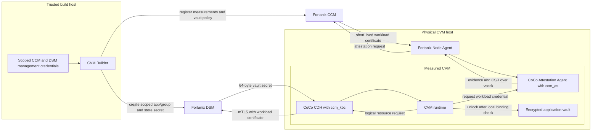

# Fortanix CCM/DSM Provider for CVM Builder

**Status:** Phase 1 provider foundation implemented; Fortanix prototype remains blocked by the service contracts in §13

**Target:** NVFlare 2.9 CVM Builder

**Date:** 2026-10-21

## 1. Decision

Add a provider interface for attestation and key release, with two implementations:

- `trustee`: the existing CoCo Trustee flow.
- `fortanix_ccm`: Fortanix Confidential Computing Manager (CCM) for attestation and Fortanix Data Security Manager (DSM) for key custody and release.

The Fortanix implementation must use the same `ccm_as` and `ccm_kbc` integration proposed for CoCo. NVFlare should not implement its own verifier or a second Fortanix attestation protocol.

An existing CoCo deployment and NVFlare may share the same Fortanix account, CCM service, DSM instance, Zone CA, and host Node Agents. They must use separate workload policies and least-privilege DSM authorization for each sealed NVFlare vault copy. Sharing the infrastructure does not imply sharing one broad runtime credential.

Trustee remains the default until the Fortanix CoCo work is upstream, versioned, and passes the acceptance tests in this proposal. Selecting `fortanix_ccm` is explicit and fail-closed.

## 2. What the CoCo reference implements

The reference is [Fortanix guest-components commit `a77b529`](https://github.com/fortanix/guest-components/commit/a77b52902554946c3cd77166483915c915465895). It builds on the earlier `ccm_as` and `ccm_kbc` work and adds encrypted-image support:

1. The Attestation Agent's `ccm_as` token provider collects SNP or TDX evidence and asks the local Fortanix Node Agent to obtain a short-lived CCM workload certificate.
2. The certificate's private key is generated in the guest. The public key, Fortanix AppConfig ID, and available NVIDIA evidence are bound into TEE report data.
3. CDH's `ccm_kbc` presents the workload certificate to DSM as an mTLS identity.
4. For encrypted OCI layers, `coco_keyprovider` creates a non-exportable AES-256 KEK in DSM. DSM wraps each layer DEK, and `ccm_kbc` later asks DSM to unwrap it. The KEK never leaves DSM.

This is the right authentication architecture for NVFlare. It is not currently a released CoCo interface. The base [CCM/DSM resource-release PR #1722](https://github.com/confidential-containers/guest-components/pull/1722) and the [non-exportable KEK PR #1727](https://github.com/confidential-containers/guest-components/pull/1727) are both open as of this proposal. The latter also has unresolved upstream design discussion about provider-specific resource URIs and image annotations. NVFlare must pin an exact reviewed revision for a prototype and move to an upstream CoCo release before production support.

The OCI-layer path is not itself the CVM vault protocol. CVM Builder releases a 64-byte LUKS secret identified by the generic CVM bundle and vault binding. The initial implementation should use CoCo's generic `get_resource` path. A later hardening step may wrap that secret with a non-exportable DSM KEK once CDH exposes a backend-neutral generic unwrap operation. NVFlare must not encode OCI annotations into the vault format or fork the CoCo image-decryption protocol.

### 2.1 Service mapping

| Existing Trustee responsibility | Fortanix responsibility |
|---|---|
| Attestation Service verifies evidence and policy | CCM verifies evidence and AppConfig policy |
| RVPS stores approved reference values | CCM policy/AppConfig stores or selects approved reference values |
| KBS stores and authorizes resources | DSM stores and authorizes secrets or KEKs |
| RCAR binds an ephemeral key to evidence | CCM binds an ephemeral certificate key to evidence |
| EAR carries signed appraisal claims | Short-lived CCM workload certificate identifies an approved AppConfig |
| Resource policy matches bundle and vault-binding path | CCM policy matches bundle and vault binding; DSM app/group scopes the resource |
| `kbs-client` attests and retrieves the secret | CoCo `ccm_as` obtains the certificate; `ccm_kbc` retrieves or unwraps the secret |

The last three rows require explicit NVFlare acceptance tests. A certificate that proves only the generic CVM bundle is not equivalent to the current Trustee policy because it does not isolate application vaults.

## 3. Required security equivalence

Fortanix support is acceptable only if it preserves these existing CVM Builder properties:

1. **Bundle approval.** A workload certificate is issued only for a measured, approved CVM bundle and acceptable platform TCB.
2. **Vault binding.** Authorization covers the exact sealed vault copy. A CVM authorized for vault A cannot request vault B's key, even when both use the same generic CVM bundle.
3. **Proof-key binding.** The workload certificate's public key is cryptographically bound to the TEE evidence. The private key never leaves the guest.
4. **Freshness.** Expired or stale credentials cannot authorize unlock, recovery, or peer proof.
5. **GPU composition.** A profile with `gpu_tee: nvidia_cc` succeeds only when the required NVIDIA evidence is present and affirmatively appraised together with the CPU evidence.
6. **Local binding.** The guest still verifies that the LUKS header-derived binding matches SNP `HOST_DATA` or TDX `MRCONFIGID` before requesting a secret.
7. **Credential separation.** CCM and DSM management credentials remain on the trusted build host. No API key is installed in a CVM, vault, delivery, log, or OCI artifact.
8. **Revocation.** Revoking a vault immediately prevents new releases without changing authorization for unrelated vaults.
9. **Fail-closed behavior.** Missing evidence, unavailable policy, unknown claims, expired certificates, unexpected redirects, or ambiguous resource mappings deny release.

The AppConfig ID used by the Fortanix attestation client is included in the report-data hash. NVFlare should use that binding to select a per-vault authorization object. Depending only on an unmeasured environment variable, kernel argument, DSM key UUID, or secret UUID is not sufficient.

## 4. Architecture



### 4.1 Reuse with CoCo

Reuse these resources when CoCo and NVFlare are in the same administrative trust domain:

- Fortanix account and tenant ownership.
- CCM and DSM service endpoints.
- CCM Zone CA and DSM trust in that CA.
- The Fortanix Node Agent already installed and registered on each physical host.
- The management and audit infrastructure around the services.
- The reviewed CoCo `ccm_as` and `ccm_kbc` guest components.

Create these resources specifically for NVFlare:

- A CCM AppConfig/policy for each sealed vault copy, or another Fortanix policy object proven to give equivalent per-vault isolation.
- A unique certificate subject or SAN for that binding.
- A DSM Trusted-CA application and DSM group for that binding, unless DSM object-level policy can prove the same isolation.
- A DSM secret or KEK and a signed binding receipt.

The default is one DSM group and runtime application per sealed vault copy because group membership is the clear DSM authorization boundary. An operator may use a less granular layout only after proving that one workload identity cannot export or decrypt another vault's object.

The trusted Stage 2 builder may use one project-scoped provisioning application to create and retire these resources. That application must not be usable by a runtime workload.

## 5. Provider model

Move Trustee-specific orchestration behind a backend-neutral interface. The interface should represent the security lifecycle, not the Trustee REST endpoints.

```python
class KeyReleaseProvider(Protocol):
    def validate_project(self, project: dict) -> None: ...
    def validate_profile(self, profile: dict) -> None: ...
    def install_profile(self, approved_bundle: dict) -> ProfileReceipt: ...
    def create_vault_binding(
        self, profile: dict, platform: str, vault_binding: str, secret: bytes
    ) -> VaultReceipt: ...
    def revoke_vault_binding(self, receipt: VaultReceipt) -> None: ...
    def render_runtime(self, profile_receipt: ProfileReceipt) -> dict: ...
    def verify_readback(self, receipt: VaultReceipt) -> None: ...
```

`ProfileReceipt` records the immutable service identity, policy revision, accepted reference values, client component revisions, and public trust roots. `VaultReceipt` records the logical resource identity and provider-specific object IDs without exposing credentials. Both are canonical JSON signed by an acceptance authority already trusted by the generic CVM.

Implementations:

- `TrusteeKeyReleaseProvider` delegates to the existing `cvm.trustee` code.
- `FortanixCcmKeyReleaseProvider` manages CCM policy/AppConfig objects and DSM resources.
- Runtime selection uses a matching `TrusteeRuntimeProvider` or `FortanixCcmRuntimeProvider`; `bootstrap.py` retains the common local-binding, key-length, LUKS, recovery, and quarantine logic.

The common runtime operation is:

```python
@contextmanager
def authorized_secret(config, vault_binding):
    """Yield exactly 64 bytes after fresh appraisal and scoped authorization."""
```

No provider returns a secret before the common code has verified the local vault binding.

## 6. Configuration

Replace the Trustee-only block in `cvm_project.yml` with an explicitly selected provider. Project configuration contains service and management settings; the application YAML continues to contain application inputs and no key-service credentials.

### 6.1 Trustee

```yaml
key_release:
  provider: trustee
  trustee:
    url: https://trustee.example.org:8443
    ca: ./inputs/kbs-ca.pem
    admin_token_file: ./inputs/kbs-resource-token.jwt

approval:
  public_keys:
    - ./inputs/acceptance-signing.pub
```

### 6.2 Fortanix CCM/DSM

```yaml
key_release:
  provider: fortanix_ccm
  fortanix_ccm:
    ccm:
      endpoint: https://ccm.example.org
      account_id: 00000000-0000-0000-0000-000000000001
      zone_ca: ./inputs/ccm-zone-ca.pem
      management_credential_file: ./inputs/ccm-builder-credential.json
      workload_certificate_max_age_seconds: 300
    dsm:
      endpoint: https://dsm.example.org
      account_id: 00000000-0000-0000-0000-000000000002
      provisioning_app_id: 00000000-0000-0000-0000-000000000003
      provisioning_api_key_file: ./inputs/dsm-builder-api-key
      group_prefix: nvflare-example
    node_agent:
      vsock_cid: 2
      vsock_port: 40

approval:
  public_keys:
    - ./inputs/acceptance-signing.pub
```

The referenced Fortanix client currently uses the host CID and port 40. Configuration must reject other values until the supported client makes them configurable. The Fortanix management credential format must follow the supported management API selected for implementation. These fields make ownership and trust boundaries explicit; they do not define a new Fortanix protocol.

Validation rules:

- Exactly one provider is selected.
- All service URLs are HTTPS and contain no embedded credentials, query, or fragment.
- All credential paths resolve relative to `cvm_project.yml`, have restrictive permissions, and are excluded from artifacts and logs.
- `account_id`, application IDs, and AppConfig IDs are canonical UUIDs or the documented Fortanix identifier format.
- The DSM endpoint, Zone CA, runtime DSM application ID, and pinned guest-component digests are measured Stage 1 inputs.
- Stage 2-generated AppConfig ID, SAN, vault binding, DSM object ID, and provider receipt are authenticated together.
- `gpu_tee: nvidia_cc` derives the GPU requirement. There is no independent `gpu_required` setting that can disagree with it.

## 7. Lifecycle

### 7.1 Stage 1: generic CVM bundle

For a Fortanix profile, Stage 1:

1. Pins a reviewed Fortanix/CoCo guest-components revision and records source and binary provenance.
2. Installs only the required `ccm_as` and `ccm_kbc` features plus a supported client entry point. It does not install a DSM API key.
3. Measures the DSM endpoint, CCM Zone CA, runtime DSM application template, Node Agent transport settings, certificate age limit, and provider receipt verification key.
4. Registers the approved SNP or TDX boot measurements and TCB requirements with CCM.
5. Records the CCM policy ID and revision in the signed profile receipt.

As with Trustee, any change to these inputs produces a new generic profile version and new measurements.

### 7.2 Stage 2: application vault

For every sealed platform copy, Stage 2:

1. Freezes the LUKS header and computes the existing `vault-binding-id`.
2. Creates a unique Fortanix AppConfig whose policy allows the approved generic bundle and requires the exact SNP `HOST_DATA` or TDX `MRCONFIGID` value for this vault binding.
3. Creates a unique workload certificate identity for the binding.
4. Creates a DSM Trusted-CA application and isolated group authorized only for this vault's resource.
5. Stores the 64-byte secret in DSM through the generic `get_resource` model.
6. Writes and signs a receipt containing the logical resource path, binding, AppConfig ID, certificate identity, DSM application/group/object IDs, policy revision, and creation transaction ID.
7. Reads back metadata and authorization before deleting the local plaintext key.

The logical identity remains:

```text
keys/<cvm-bundle-id>/<vault-binding-id>
```

DSM UUIDs are implementation metadata and never replace this public contract. The provider receipt maps the logical identity to DSM objects.

For a future non-exportable-KEK mode, Stage 2 asks DSM to wrap the 64-byte vault secret with a per-vault AES-256 KEK lacking `EXPORT`. The signed receipt additionally contains ciphertext, IV, tag, and KEK UUID. Runtime asks DSM to decrypt that envelope using a backend-neutral CDH operation. This mode is enabled only after that operation is available without an NVFlare-only guest-components fork.

### 7.3 Boot and unlock

1. The runtime computes the vault binding from the attached LUKS header.
2. It verifies that the local TEE field equals the binding before contacting any service.
3. `ccm_as` generates an ephemeral workload key and requests a certificate using the signed per-vault AppConfig ID.
4. CCM verifies CPU evidence, approved measurements, the exact vault binding, TCB policy, AppConfig binding, proof-key binding, and required GPU evidence.
5. `ccm_kbc` presents the certificate to the per-vault DSM application and requests the logical resource mapped by the signed receipt.
6. The runtime accepts exactly 64 bytes, keeps them in protected memory, unlocks the vault, and zeroizes the temporary buffer.

Changing an AppConfig ID, certificate SAN, DSM object ID, endpoint, or receipt must produce either a local verification failure or a remote authorization denial. It must never select a broader default application.

### 7.4 Renewal and peer proof

The reference `ccm_as` implementation caches a workload certificate until its X.509 expiration. NVFlare currently obtains fresh Trustee appraisal for unlock, recovery, periodic health checks, and optional peer credentials. Fortanix mode must provide one of these mechanisms:

- Configure CCM certificates with a lifetime no longer than NVFlare's maximum appraisal age and refresh them before the existing bounded renewal deadline; or
- Add an upstream `force_refresh` operation to `ccm_as` and call it for every NVFlare renewal cycle.

The runtime must reject a certificate whose age exceeds the configured NVFlare limit even when its X.509 `notAfter` is later.

Rename the application-facing proof file to a provider-neutral `attestation_credentials.json`. A Fortanix entry carries the certificate chain, ephemeral private key, AppConfig ID, vault binding, certificate validity, and signed profile/vault receipt digests. Peers trust the CCM Zone CA and the federation's signed mapping from AppConfig ID to approved profile and vault binding. Trustee entries retain the current EAR and proof key. The application never receives DSM management credentials.

### 7.5 Revocation and cleanup

Revocation disables the DSM runtime application first, then disables the CCM AppConfig, and finally retires or destroys the DSM object according to the project's retention policy. The receipt records each idempotent step. A partially completed revocation is treated as revoked; retry logic may only remove access, never recreate it.

Deleting a vault build that failed before publication follows the same fenced cleanup. Audit records must correlate the CVM bundle ID, vault binding, CCM AppConfig, DSM application, group, object, and NVFlare transaction ID.

## 8. GPU support

The Fortanix attestation revision used by the reference enables `nvidia-evidence` and attempts to include NVIDIA evidence for both SNP and TDX. That is not yet enough for NVFlare production support:

- The referenced code logs failure to collect GPU evidence and continues with CPU evidence. A GPU-required NVFlare profile must instead fail before certificate issuance.
- CCM policy must validate the same driver RIM, VBIOS RIM, certificate chains, measurements, debug state, device count, and freshness that the current Trustee policy requires.
- The workload certificate or a signed CCM result must let NVFlare and its peers distinguish a CPU-only appraisal from a successful CPU+GPU composite appraisal.
- GPU disappearance after unlock remains a terminal quarantine event.

Until Fortanix provides and NVFlare tests those properties, configuration validation rejects `key_release.provider: fortanix_ccm` together with `gpu_tee: nvidia_cc`. CPU-only SNP and TDX are the first supported profiles. GPU support is enabled per platform only after the negative test matrix passes; evidence collection alone does not enable it.

## 9. Package changes

Proposed layout:

```text
cvm/
├── key_release/
│   ├── base.py
│   ├── contracts.py
│   ├── trustee/
│   │   ├── admin.py
│   │   └── runtime.py
│   └── fortanix/
│       ├── admin.py
│       ├── receipts.py
│       └── runtime.py
├── runtime/
│   ├── attestation.py       # common local binding and provider dispatch
│   └── bootstrap.py         # common unlock/recovery/quarantine
└── build/
    └── config.py            # strict provider schema
```

`cvm.key_release.fortanix.runtime` should invoke supported CoCo guest components. It must not contain TEE quote parsing, CCM certificate issuance, or a reimplementation of the DSM client. If CoCo exposes an external resource-provider API before `ccm_kbc` is released, prefer that API so NVFlare can consume stock CoCo binaries plus a Fortanix-maintained provider.

## 10. Migration

Changing an existing deployment from Trustee to Fortanix is a rebuild and reseal operation:

1. Create and approve a new generic profile containing the Fortanix runtime, endpoints, and trust roots.
2. Register the approved measurements and policies in CCM.
3. Recreate every application vault copy with a new key and vault binding.
4. Provision its Fortanix AppConfig and DSM authorization.
5. Test recovery and revocation before switching the deployment.
6. Retain the old Trustee resources until rollback is no longer required, then revoke them.

Do not copy a raw vault key from Trustee to DSM through an unattended migration command. If preserving an existing encrypted vault is mandatory, require a separately audited key-transfer ceremony on a trusted host and issue a new signed receipt.

The Trustee and Fortanix providers may coexist across different profile versions. One running CVM profile uses one provider; runtime fallback from Fortanix to Trustee is forbidden.

## 11. Implementation phases

### Phase 0: compatibility proof

- Confirm supported CCM and DSM versions, APIs, licensing, certificate lifetime controls, and Node Agent deployment model with Fortanix.
- Confirm that CCM policy can require the exact SNP `HOST_DATA` or TDX `MRCONFIGID` vault binding and the supplied AppConfig ID.
- Confirm DSM per-vault isolation through separate groups/applications or an equivalent object-level policy.
- Confirm how an attested AppConfig identity appears in the CCM-issued certificate and DSM audit log.
- Track CoCo PRs #1722 and #1727 and select a versioned upstream dependency.

### Phase 1: provider abstraction

- Extract current Trustee build and runtime calls behind `KeyReleaseProvider`.
- Add strict `key_release.provider` configuration and receipts.
- Keep behavior and tests unchanged for Trustee.

Implemented in the provider-abstraction change. The measured profile now pins
`key_release_provider`, `cvm_project.yml` strictly selects one matching
provider, Trustee publication is behind `KeyReleaseProvider`, management
credentials require restrictive permissions, and runtime selection has no
fallback. The Fortanix project schema is accepted and validated, then fails
before image retrieval or key creation. A Fortanix measured profile is also
rejected until the released CoCo interface and vault-bound management contract
listed in §13 exist. This is an intentional security gate, not a stub that may
be bypassed in production.

### Phase 2: CPU-only Fortanix prototype

- Integrate the exact CoCo `ccm_as` and `ccm_kbc` components.
- Add CCM profile/AppConfig and DSM lifecycle management.
- Support CPU-only SNP and TDX vault unlock, recovery, renewal, revocation, and audit correlation.

### Phase 3: peer credentials and operations

- Add provider-neutral application credentials and peer verification.
- Add forced refresh or bounded certificate lifetimes.
- Add operational documentation, diagnostics, cleanup, and rotation.

### Phase 4: GPU and non-exportable KEK

- Make missing NVIDIA evidence fatal when `gpu_tee: nvidia_cc`.
- Prove CCM appraisal parity and enable qualified SNP/TDX GPU profiles.
- Adopt a generic DSM unwrap path after it is supported by CoCo without provider-specific vault formats.

## 12. Test and acceptance matrix

Unit and contract tests:

- Strict parsing and secret-path handling for both providers.
- Common provider lifecycle contract and deterministic logical resource identity.
- Signed receipt verification and rejection of altered AppConfig, SAN, DSM UUID, binding, or policy revision.
- Management credentials never enter payload lists, manifests, deliveries, logs, exceptions, or OCI layers.
- Provider failure cannot trigger fallback.

End-to-end tests against the same Fortanix account and DSM instance used by a CoCo test deployment:

| Case | Required result |
|---|---|
| Approved SNP CPU CVM | Unlock, run job, recover, and re-attest |
| Approved TDX CPU CVM | Unlock, run job, recover, and re-attest |
| CoCo workload and NVFlare CVM concurrently | Both succeed with separate audit identities and no credential changes |
| Vault A requests vault B resource | Denied by DSM even if the object UUID is known |
| Wrong AppConfig or certificate SAN | Denied |
| Modified SNP `HOST_DATA` or TDX `MRCONFIGID` | CCM denies certificate |
| Unapproved measurement or unacceptable TCB | CCM denies certificate |
| Expired, revoked, or over-age certificate | DSM/runtime denies release |
| Disabled DSM application or revoked object | Release and recovery denied |
| Node Agent or CCM unavailable | Bounded failure; vault remains locked |
| DSM unavailable or redirects | Bounded failure; vault remains locked |
| GPU-required profile with missing GPU evidence | Certificate/release denied |
| Qualified SNP/TDX plus NVIDIA GPU | CPU and every GPU affirm; job runs; loss causes terminal quarantine |

Production enablement requires successful tests on two physical lab hosts, restart and recovery tests, forced negative tests, audit-log review, and confirmation that no code or configuration is edited between provisioning and the test run.

## 13. Open decisions

The following are blockers, not deferred implementation details:

1. Which released CoCo guest-components version contains supported `ccm_as` and `ccm_kbc` interfaces?
2. Can CCM enforce the exact NVFlare vault-binding claim per AppConfig and include enough identity in the workload certificate for DSM and peer verification?
3. What DSM layout provides practical per-vault isolation without creating unmanageable object counts?
4. Can CCM enforce NVFlare's certificate freshness requirement, or will `ccm_as` add forced refresh?
5. Does CCM appraise all required NVIDIA claims and fail when evidence is absent for both SNP and TDX?
6. Will CoCo expose a provider-neutral generic unwrap operation for non-exportable DSM KEKs?
7. Can Fortanix supply a stable, documented management API for policy, AppConfig, Trusted-CA application, group, and audit lifecycle automation?

Proceed with Phase 1 while these are answered. Start a CPU-only prototype after questions 1, 2, 3, 4, and 7 have verified answers. Do not advertise Fortanix as a production Trustee replacement until the full acceptance matrix passes.

## 14. References

- [Fortanix guest-components commit `a77b529`](https://github.com/fortanix/guest-components/commit/a77b52902554946c3cd77166483915c915465895)
- [CoCo `ccm_as` and `ccm_kbc` PR #1722](https://github.com/confidential-containers/guest-components/pull/1722)
- [CoCo DSM non-exportable KEK PR #1727](https://github.com/confidential-containers/guest-components/pull/1727)
- [CoCo Fortanix KBC RFC #1513](https://github.com/confidential-containers/guest-components/issues/1513)
- [Fortanix DSM certificate and Trusted CA authentication](https://support.fortanix.com/v1/docs/dsm-authentication)
- [CoCo architecture](https://github.com/confidential-containers/confidential-containers/blob/main/architecture.md)
